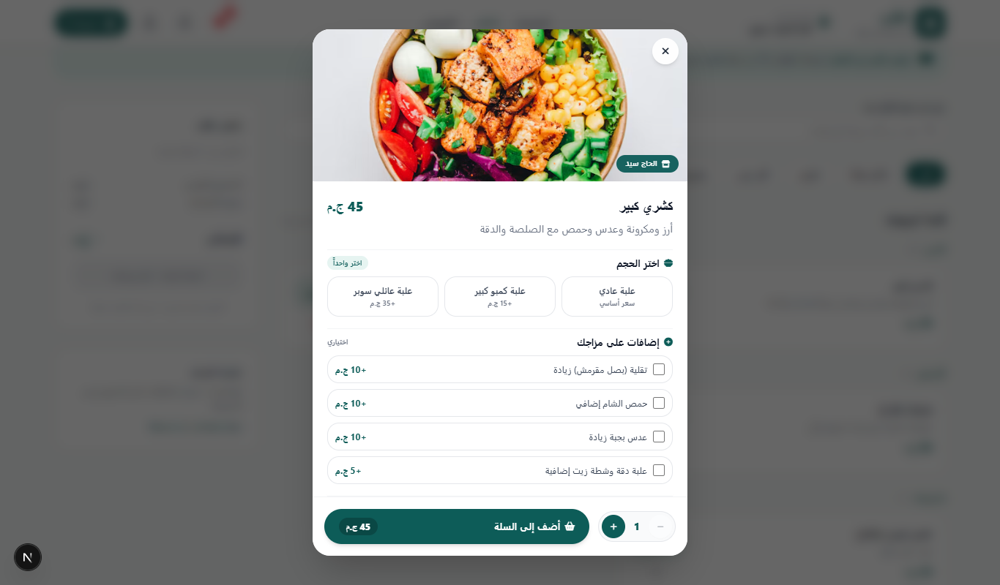

# 🍔 Otlob - Modern Food Ordering Platform

A full-stack, responsive food ordering web application built with **Next.js**, **Supabase**, and modern front-end tooling. The platform features store exploration, product discovery, reviews, real-time orders, and an authentication flow.

---

## 🚀 Features

- **Store & Product Catalog:** Browse restaurants, filter categories, and inspect detailed menus with dynamic pricing.
- **Cart & Order Management:** Modular order processing pipeline and streamlined checkout services.
- **Authentication & Security:** Supabase auth integration, server-side route guards, and built-in CSRF protection.
- **Reviews & Ratings:** Integrated user feedback and store rating services.
- **Responsive & Mobile-First:** Tailored UI layouts for both desktop viewports and mobile devices.

---

## 📸 Screenshots Preview

|        Store View (Desktop)         |        Store View (Mobile)        |
| :---------------------------------: | :-------------------------------: |
|  |  |

|        Auth Flow (Desktop)        |       Auth Flow (Mobile)        |
| :-------------------------------: | :-----------------------------: |
|  |  |

|          Modals & Dialogs           |      Navigation (Mobile)      |
| :---------------------------------: | :---------------------------: |
|  |  |

---

## 🛠️ Tech Stack

- **Framework:** Next.js (App Router)
- **Styling:** Tailwind CSS & PostCSS
- **Backend & Database:** Supabase (Auth, PostgreSQL, Realtime)
- **State & Data Fetching:** Modular Service Layer (`orders`, `payments`, `products`, `reviews`, `stores`)
- **Code Quality:** ESLint

---

## 📁 Architecture & Services

```text
├── services/
│   ├── orders.service.js      # Order lifecycle & checkout handlers
│   ├── payments.service.js    # Payment processing flows
│   ├── products.service.js    # Product queries & mutations
│   ├── reviews.service.js     # User ratings & feedback
│   └── stores.service.js      # Restaurant profiles & inventory
├── supabase/                  # Supabase clients & database utilities
├── proxy.js                   # API proxying & route redirection
└── ...
```
